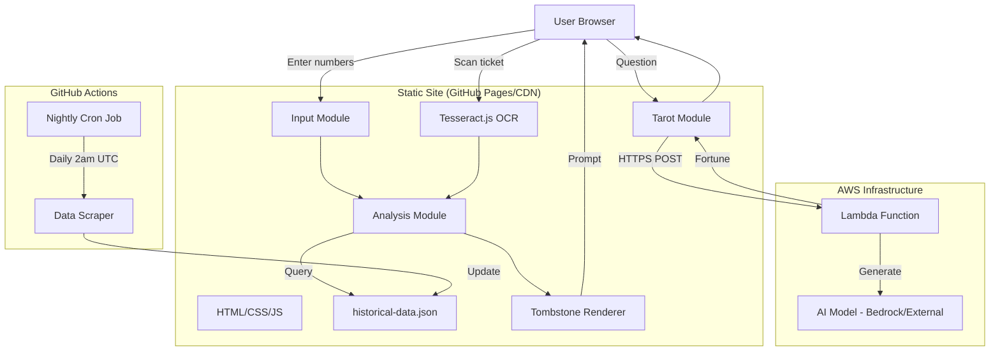

# Design Document

## Overview

The Lotto Graveyard is a static web application that analyzes Powerball lottery numbers against historical data and provides mystical tarot readings. The system operates entirely in the browser except for AI-powered fortune generation, which uses an AWS Lambda function. The application features a 1909 Rider-Waite artistic theme throughout.

### Architecture Principles

1. **Static-First**: All UI and business logic runs client-side using vanilla JavaScript
2. **Serverless Fortune Generation**: AWS Lambda handles AI-powered fortunes via Function URL
3. **Flat File Data**: Historical lottery data stored as JSON, updated nightly via GitHub Actions
4. **Privacy-Preserving OCR**: Webcam scanning runs entirely in-browser using Tesseract.js
5. **Deterministic Readings**: Same lottery numbers + question always produce identical tarot spreads

### Key User Flows

1. **Number Input Flow**: Manual entry or webcam scan → validation → historical analysis
2. **Analysis Flow**: Query flat file → calculate statistics → render tombstone
3. **Tarot Flow**: Prompt user → collect question → deterministic card selection → Lambda fortune generation → display reading

## Architecture

### System Diagram



### Technology Stack

**Frontend**
- HTML5, CSS3, vanilla JavaScript (ES6+)
- Tesseract.js v5+ for OCR
- Seedrandom library for deterministic RNG
- LocalStorage for caching

**Backend**
- AWS Lambda (Node.js 20.x runtime)
- AWS Bedrock or external AI API for fortune generation
- Lambda Function URL with CORS

**Data Pipeline**
- GitHub Actions (cron schedule)
- Python or Node.js scraper
- JSON flat file storage

**Deployment**
- GitHub Pages or S3 + CloudFront
- Static asset hosting

## Components and Interfaces

### 1. Input Module

**Purpose**: Handles lottery number input via manual entry and webcam scanning.

**Files**: `input.js`, `input.css`, `index.html`

**Public Interface**:
```javascript
class InputModule {
  // Initialize input UI
  init(containerElement)
  
  // Set callback for valid lottery numbers
  onNumbersValidated(callback)
  
  // Get current lottery numbers
  getLotteryNumbers() // Returns: { whiteBalls: number[], powerball: number }
  
  // Reset input state
  reset()
}
```

**Key Methods**:

```javascript
// Validate lottery numbers
function validateLotteryNumbers(whiteBalls, powerball) {
  // Returns: { valid: boolean, errors: string[] }
  // Rules:
  // - Exactly 5 white balls
  // - White balls: 1-69, unique
  // - Powerball: 1-26, required
}

// Handle manual input submission
function handleManualInput(formData)

// Switch between manual and webcam modes
function toggleInputMode(mode) // mode: 'manual' | 'webcam'
```

**State Management**:
```javascript
{
  mode: 'manual' | 'webcam',
  whiteBalls: number[5],
  powerball: number,
  validationErrors: string[]
}
```

### 2. Webcam Scanner Module

**Purpose**: Captures lottery ticket images and extracts numbers using OCR.

**Files**: `webcam-scanner.js`, `scanner.css`

**Dependencies**: Tesseract.js v5.x

**Public Interface**:
```javascript
class WebcamScanner {
  // Initialize scanner with video element
  init(videoElement, canvasElement)
  
  // Request camera permissions and start stream
  async startCamera()
  
  // Stop camera and release resources
  stopCamera()
  
  // Scan current frame for lottery numbers
  async scanFrame() // Returns: { whiteBalls: number[], powerball: number } | null
  
  // Set callback for successful scan
  onNumbersDetected(callback)
}
```

**OCR Configuration**:
```javascript
const OCR_CONFIG = {
  lang: 'eng',
  oem: 1, // LSTM OCR Engine Mode
  psm: 6, // Assume uniform block of text
  tessedit_char_whitelist: '0123456789 ',
  timeout: 30000 // 30 second timeout per requirements
}
```

**Number Extraction Algorithm**:
1. Capture frame from video stream
2. Apply preprocessing: grayscale, contrast enhancement, binarization
3. Run Tesseract OCR on preprocessed image
4. Parse text output for digit sequences
5. Apply heuristics to identify 5 white balls (1-69) and 1 powerball (1-26)
6. Validate extracted numbers
7. Display for user confirmation

**Preprocessing Pipeline**:
```javascript
function preprocessImage(imageData) {
  // 1. Convert to grayscale
  const gray = toGrayscale(imageData)
  
  // 2. Increase contrast
  const contrasted = adjustContrast(gray, 1.5)
  
  // 3. Apply adaptive thresholding
  const binary = adaptiveThreshold(contrasted)
  
  // 4. Morphological operations to clean noise
  const cleaned = morphologicalClose(binary)
  
  return cleaned
}
```

**Scan State Machine**:
```
IDLE → REQUESTING_PERMISSION → STREAMING → SCANNING → CONFIRMING → COMPLETE
                              ↓           ↓          ↓
                           ERROR ←────────┴──────────┘
```

### 3. Historical Analysis Module

**Purpose**: Queries historical Powerball data and calculates statistics.

**Files**: `analysis.js`, `data-loader.js`

**Public Interface**:
```javascript
class HistoricalAnalysis {
  // Load historical data
  async loadData()
  
  // Analyze lottery numbers against historical data
  analyze(lotteryNumbers) // Returns: AnalysisResult
  
  // Get cached data status
  getDataStatus() // Returns: { loaded: boolean, lastUpdated: Date, drawingsCount: number }
}
```

**Data Structures**:
```javascript
// Historical drawing record
interface Drawing {
  drawDate: string,        // ISO 8601 format
  whiteBalls: number[5],   // Sorted array [1-69]
  powerball: number,       // [1-26]
  jackpot: number          // Optional, for display
}

// Analysis result
interface AnalysisResult {
  numbers: LotteryNumbers,
  exactMatch: Drawing | null,
  closestMatch: {
    drawing: Drawing,
    whiteMatches: number,  // 0-5
    powerballMatch: boolean
  },
  dateRange: {
    earliest: string,
    latest: string
  },
  frequency: {
    whiteBalls: { [number]: number },  // Count per white ball
    powerball: number                  // Count for powerball
  },
  totalDrawings: number
}
```

**Analysis Algorithm**:
```javascript
function analyzeNumbers(drawings, lotteryNumbers) {
  const pastYearDrawings = filterPastYear(drawings)
  
  // 1. Check for exact match (all 5 white + powerball)
  const exactMatch = findExactMatch(drawings, lotteryNumbers)
  
  // 2. Find closest near-miss
  const closestMatch = findClosestMatch(drawings, lotteryNumbers)
  
  // 3. Calculate frequency for past year
  const frequency = calculateFrequency(pastYearDrawings, lotteryNumbers)
  
  // 4. Determine date range
  const dateRange = getDateRange(drawings)
  
  return {
    numbers: lotteryNumbers,
    exactMatch,
    closestMatch,
    dateRange,
    frequency,
    totalDrawings: drawings.length
  }
}

function findClosestMatch(drawings, lotteryNumbers) {
  let best = { drawing: null, whiteMatches: 0, powerballMatch: false }
  
  for (const drawing of drawings) {
    const whiteMatches = countWhiteBallMatches(drawing.whiteBalls, lotteryNumbers.whiteBalls)
    const powerballMatch = drawing.powerball === lotteryNumbers.powerball
    const totalScore = whiteMatches + (powerballMatch ? 1 : 0)
    const bestScore = best.whiteMatches + (best.powerballMatch ? 1 : 0)
    
    if (totalScore > bestScore) {
      best = { drawing, whiteMatches, powerballMatch }
    }
  }
  
  return best
}

function calculateFrequency(drawings, lotteryNumbers) {
  const frequency = {
    whiteBalls: {},
    powerball: 0
  }
  
  // Initialize counts
  lotteryNumbers.whiteBalls.forEach(num => frequency.whiteBalls[num] = 0)
  
  // Count occurrences
  for (const drawing of drawings) {
    lotteryNumbers.whiteBalls.forEach(num => {
      if (drawing.whiteBalls.includes(num)) {
        frequency.whiteBalls[num]++
      }
    })
    
    if (drawing.powerball === lotteryNumbers.powerball) {
      frequency.powerball++
    }
  }
  
  return frequency
}
```

**Data Loading & Caching**:
```javascript
class DataLoader {
  async loadHistoricalData() {
    // 1. Check localStorage cache
    const cached = this.getCachedData()
    if (cached && this.isCacheValid(cached)) {
      return cached.data
    }
    
    // 2. Fetch from server
    const response = await fetch('/data/historical-data.json')
    const data = await response.json()
    
    // 3. Validate data format
    this.validateData(data)
    
    // 4. Cache in localStorage
    this.cacheData(data)
    
    return data
  }
  
  isCacheValid(cached) {
    // Cache valid for current browsing session
    const sessionStart = sessionStorage.getItem('sessionStart')
    return cached.timestamp > sessionStart
  }
}
```

### 4. Tombstone Renderer

**Purpose**: Displays lottery numbers and analysis results in Rider-Waite themed tombstone graphic.

**Files**: `tombstone.js`, `tombstone.css`

**Public Interface**:
```javascript
class TombstoneRenderer {
  // Render tombstone with analysis results
  render(analysisResult, containerElement)
  
  // Generate epitaph text from analysis
  generateEpitaph(analysisResult) // Returns: string
}
```

**Responsive Layout Breakpoints**:
```css
/* Desktop: >= 768px */
.tombstone {
  width: 400px;
  min-width: 400px;
  layout: vertical;
}

/* Mobile: < 768px */
.tombstone {
  width: calc(100vw - 32px);
  layout: single-column;
}

/* Typography scaling */
.tombstone-numbers {
  font-size: max(24pt, 150% of body); /* Per requirements */
}

.tombstone-text {
  font-size: max(14pt, 1rem); /* Minimum readable size */
}
```

**Epitaph Generation**:
```javascript
function generateEpitaph(analysis) {
  let epitaph = `Numbers: ${formatNumbers(analysis.numbers)}\n\n`
  
  // Win status
  if (analysis.exactMatch) {
    epitaph += `These numbers WON on ${formatDate(analysis.exactMatch.drawDate)}!\n\n`
  } else {
    epitaph += `These numbers never won the jackpot.\n\n`
  }
  
  // Closest match
  const { whiteMatches, powerballMatch } = analysis.closestMatch
  epitaph += `Closest: ${whiteMatches} white ball${whiteMatches !== 1 ? 's' : ''}`
  if (powerballMatch) {
    epitaph += ` + Powerball`
  }
  epitaph += ` on ${formatDate(analysis.closestMatch.drawing.drawDate)}\n\n`
  
  // Date range
  epitaph += `Analyzed: ${formatDate(analysis.dateRange.earliest)} to ${formatDate(analysis.dateRange.latest)}\n\n`
  
  // Frequency (past year)
  epitaph += `Past Year Frequency:\n`
  analysis.numbers.whiteBalls.forEach(num => {
    const count = analysis.frequency.whiteBalls[num]
    epitaph += `  Ball ${num}: ${count} time${count !== 1 ? 's' : ''}\n`
  })
  epitaph += `  Powerball ${analysis.numbers.powerball}: ${analysis.frequency.powerball} time${analysis.frequency.powerball !== 1 ? 's' : ''}\n`
  
  return epitaph
}
```

**Visual Styling**:
- Grayscale color palette (#000, #333, #666, #999, #CCC, #FFF)
- Serif typography (Georgia, Times New Roman, serif)
- Rider-Waite decorative border elements (SVG or image assets)
- Tombstone shape using CSS border-radius and box-shadow

### 5. Tarot Module

**Purpose**: Generates deterministic tarot card selections and coordinates fortune generation.

**Files**: `tarot.js`, `tarot.css`

**Dependencies**: seedrandom library for deterministic RNG

**Public Interface**:
```javascript
class TarotModule {
  // Initialize with tarot deck data
  init(deckData)
  
  // Show tarot reading prompt after tombstone
  showPrompt(lotteryNumbers, containerElement)
  
  // Collect user question
  async collectQuestion() // Returns: string (1-200 chars)
  
  // Select 3 cards deterministically
  selectCards(lotteryNumbers, question) // Returns: Card[3]
  
  // Request fortune from Lambda
  async generateFortune(cards, question) // Returns: string
  
  // Display complete reading
  displayReading(cards, fortune, containerElement)
}
```

**Data Structures**:
```javascript
// Tarot deck: 78 cards
interface Card {
  id: number,           // 0-77
  name: string,         // e.g., "The Fool", "Ace of Cups"
  arcana: 'major' | 'minor',
  suit?: string,        // For minor arcana: 'wands' | 'cups' | 'swords' | 'pentacles'
  imageUrl: string      // Path to 1909 Rider-Waite image
}

// Three-card spread
interface Reading {
  cards: [Card, Card, Card],
  positions: ['past', 'present', 'future'],
  question: string,
  fortune: string
}
```

**Deterministic Card Selection Algorithm**:
```javascript
function selectCards(lotteryNumbers, question) {
  // 1. Create seed from lottery numbers and question
  const seed = createSeed(lotteryNumbers, question)
  
  // 2. Initialize seeded RNG
  const rng = seedrandom(seed)
  
  // 3. Shuffle deck using Fisher-Yates with seeded RNG
  const deck = [...TAROT_DECK] // 78 cards
  for (let i = deck.length - 1; i > 0; i--) {
    const j = Math.floor(rng() * (i + 1))
    ;[deck[i], deck[j]] = [deck[j], deck[i]]
  }
  
  // 4. Select first 3 unique cards
  return [deck[0], deck[1], deck[2]]
}

function createSeed(lotteryNumbers, question) {
  // Combine lottery numbers and question into deterministic seed
  const numberPart = lotteryNumbers.whiteBalls.join(',') + '|' + lotteryNumbers.powerball
  const questionPart = question.toLowerCase().trim()
  return `${numberPart}::${questionPart}`
}
```

**Question Validation**:
```javascript
function validateQuestion(question) {
  const trimmed = question.trim()
  
  if (trimmed.length === 0) {
    return { valid: false, error: 'Question is required' }
  }
  
  if (trimmed.length > 200) {
    return { valid: false, error: 'Question must be 200 characters or less' }
  }
  
  // Check for at least one non-whitespace character
  if (!/\S/.test(question)) {
    return { valid: false, error: 'Question must contain text' }
  }
  
  return { valid: true }
}
```

**Tarot Deck Data**:
```javascript
// 22 Major Arcana (0-21)
const MAJOR_ARCANA = [
  { id: 0, name: 'The Fool', arcana: 'major', imageUrl: '/assets/tarot/major-00-fool.jpg' },
  { id: 1, name: 'The Magician', arcana: 'major', imageUrl: '/assets/tarot/major-01-magician.jpg' },
  // ... remaining 20 cards
]

// 56 Minor Arcana (22-77)
const MINOR_ARCANA = [
  // Wands (22-35)
  { id: 22, name: 'Ace of Wands', arcana: 'minor', suit: 'wands', imageUrl: '/assets/tarot/wands-01.jpg' },
  // ... remaining wands
  
  // Cups (36-49)
  { id: 36, name: 'Ace of Cups', arcana: 'minor', suit: 'cups', imageUrl: '/assets/tarot/cups-01.jpg' },
  // ... remaining cups
  
  // Swords (50-63)
  { id: 50, name: 'Ace of Swords', arcana: 'minor', suit: 'swords', imageUrl: '/assets/tarot/swords-01.jpg' },
  // ... remaining swords
  
  // Pentacles (64-77)
  { id: 64, name: 'Ace of Pentacles', arcana: 'minor', suit: 'pentacles', imageUrl: '/assets/tarot/pentacles-01.jpg' },
  // ... remaining pentacles
]

const TAROT_DECK = [...MAJOR_ARCANA, ...MINOR_ARCANA] // 78 cards total
```

### 6. Fortune Generator Lambda

**Purpose**: Generates AI-powered fortune interpretations based on tarot cards and user questions.

**Runtime**: Node.js 20.x

**Deployment**: AWS Lambda with Function URL

**Files**: `lambda/fortune-generator/index.js`, `lambda/fortune-generator/package.json`

**API Endpoint**:
```
POST https://{function-url}.lambda-url.{region}.on.aws/
Content-Type: application/json
```

**Request Schema**:
```javascript
{
  question: string,      // 1-200 characters
  cards: [
    {
      name: string,
      position: 'past' | 'present' | 'future'
    },
    // ... 3 cards total
  ]
}
```

**Response Schema**:
```javascript
// Success (200)
{
  fortune: string,       // >= 100 characters
  generatedAt: string    // ISO 8601 timestamp
}

// Error (400)
{
  error: string,
  message: string
}

// Error (500)
{
  error: string,
  message: string
}
```

**Lambda Handler**:
```javascript
export const handler = async (event) => {
  // 1. Parse request
  const { question, cards } = JSON.parse(event.body)
  
  // 2. Validate input
  if (!question || question.length > 200) {
    return errorResponse(400, 'Invalid question')
  }
  
  if (!cards || cards.length !== 3) {
    return errorResponse(400, 'Must provide exactly 3 cards')
  }
  
  // 3. Generate fortune using AI model
  try {
    const fortune = await generateFortune(question, cards)
    
    // 4. Validate fortune length
    if (fortune.length < 100) {
      throw new Error('Generated fortune too short')
    }
    
    return {
      statusCode: 200,
      headers: {
        'Content-Type': 'application/json',
        'Access-Control-Allow-Origin': '*', // CORS for static site
        'Access-Control-Allow-Methods': 'POST, OPTIONS',
        'Access-Control-Allow-Headers': 'Content-Type'
      },
      body: JSON.stringify({
        fortune,
        generatedAt: new Date().toISOString()
      })
    }
  } catch (error) {
    console.error('Fortune generation error:', error)
    return errorResponse(500, 'Fortune generation failed')
  }
}

async function generateFortune(question, cards) {
  // Build AI prompt
  const prompt = buildPrompt(question, cards)
  
  // Call AI service (AWS Bedrock, OpenAI, Anthropic, etc.)
  const response = await callAIService(prompt)
  
  return response
}

function buildPrompt(question, cards) {
  return `You are a mystical tarot reader interpreting a three-card spread in the style of 1909 Rider-Waite symbolism.

User's Question: "${question}"

Cards Drawn:
- Past: ${cards[0].name}
- Present: ${cards[1].name}
- Future: ${cards[2].name}

Provide a cohesive interpretation that:
1. Addresses the user's question directly
2. Explains the significance of each card in its position
3. Weaves the three cards into a narrative about past, present, and future
4. Uses evocative, mystical language befitting the Rider-Waite tradition
5. Is at least 150 words

Generate the fortune:`
}
```

**CORS Configuration**:
```javascript
// Lambda Function URL CORS settings
{
  AllowOrigins: ['*'],  // Or specific domain: ['https://lotto-graveyard.example.com']
  AllowMethods: ['POST', 'OPTIONS'],
  AllowHeaders: ['Content-Type'],
  MaxAge: 86400  // 24 hours
}
```

**Timeout & Retry Handling**:
- Lambda timeout: 30 seconds (per requirements)
- Client timeout: 30 seconds
- Max retry attempts: 3 (per requirements)
- Exponential backoff: 1s, 2s, 4s

**Client-Side Integration**:
```javascript
class FortuneClient {
  constructor(lambdaUrl) {
    this.lambdaUrl = lambdaUrl
    this.maxRetries = 3
    this.timeout = 30000
  }
  
  async generateFortune(question, cards, attempt = 1) {
    const controller = new AbortController()
    const timeoutId = setTimeout(() => controller.abort(), this.timeout)
    
    try {
      const response = await fetch(this.lambdaUrl, {
        method: 'POST',
        headers: { 'Content-Type': 'application/json' },
        body: JSON.stringify({ question, cards }),
        signal: controller.signal
      })
      
      clearTimeout(timeoutId)
      
      if (!response.ok) {
        throw new Error(`HTTP ${response.status}`)
      }
      
      const data = await response.json()
      return data.fortune
      
    } catch (error) {
      clearTimeout(timeoutId)
      
      if (attempt < this.maxRetries) {
        // Exponential backoff
        const delay = Math.pow(2, attempt - 1) * 1000
        await sleep(delay)
        return this.generateFortune(question, cards, attempt + 1)
      }
      
      throw error
    }
  }
}
```

### 7. GitHub Actions Data Pipeline

**Purpose**: Automatically updates historical Powerball data nightly.

**Files**: `.github/workflows/update-lottery-data.yml`, `scripts/fetch-powerball-data.js`

**Workflow Configuration**:
```yaml
name: Update Lottery Data

on:
  schedule:
    - cron: '0 2 * * *'  # 2am UTC daily
  workflow_dispatch:      # Manual trigger

jobs:
  update-data:
    runs-on: ubuntu-latest
    steps:
      - name: Checkout repository
        uses: actions/checkout@v4
      
      - name: Setup Node.js
        uses: actions/setup-node@v4
        with:
          node-version: '20'
      
      - name: Install dependencies
        run: npm install
      
      - name: Fetch latest Powerball data
        run: node scripts/fetch-powerball-data.js
      
      - name: Commit and push if changed
        run: |
          git config --local user.email "github-actions[bot]@users.noreply.github.com"
          git config --local user.name "github-actions[bot]"
          git add data/historical-data.json
          git diff --quiet && git diff --staged --quiet || \
            (git commit -m "Update Powerball data - $(date +'%Y-%m-%d')" && git push)
```

**Data Fetcher Script**:
```javascript
// scripts/fetch-powerball-data.js
import fs from 'fs'
import path from 'path'

async function fetchPowerballData() {
  // Option 1: Use lottery API service
  // const response = await fetch('https://api.lotteryapi.example/powerball/history')
  
  // Option 2: Scrape from official Powerball site
  const response = await fetch('https://www.powerball.com/api/v1/numbers/powerball/recent')
  
  const rawData = await response.json()
  
  // Transform to our format
  const drawings = rawData.map(draw => ({
    drawDate: draw.draw_date,
    whiteBalls: draw.white_balls.sort((a, b) => a - b),
    powerball: draw.powerball,
    jackpot: draw.jackpot_amount
  }))
  
  // Sort by date (newest first)
  drawings.sort((a, b) => new Date(b.drawDate) - new Date(a.drawDate))
  
  // Write to file
  const outputPath = path.join(process.cwd(), 'data', 'historical-data.json')
  fs.writeFileSync(outputPath, JSON.stringify({
    lastUpdated: new Date().toISOString(),
    totalDrawings: drawings.length,
    drawings
  }, null, 2))
  
  console.log(`Updated ${drawings.length} drawings`)
}

fetchPowerballData().catch(error => {
  console.error('Error fetching data:', error)
  process.exit(1)
})
```

**Data Format**:
```javascript
// data/historical-data.json
{
  lastUpdated: "2025-01-15T02:00:00Z",
  totalDrawings: 2847,
  drawings: [
    {
      drawDate: "2025-01-14",
      whiteBalls: [3, 15, 24, 42, 67],
      powerball: 12,
      jackpot: 450000000
    },
    // ... more drawings
  ]
}
```

## Data Models

### Lottery Numbers
```typescript
interface LotteryNumbers {
  whiteBalls: number[]  // Length 5, values 1-69, unique, sorted
  powerball: number     // Value 1-26
}
```

**Validation Rules**:
- `whiteBalls.length === 5`
- `whiteBalls.every(n => n >= 1 && n <= 69)`
- `new Set(whiteBalls).size === 5` (all unique)
- `powerball >= 1 && powerball <= 26`

**Normalization**:
- White balls always stored sorted ascending
- Leading zeros removed from manual input

### Historical Drawing
```typescript
interface Drawing {
  drawDate: string        // ISO 8601 (YYYY-MM-DD)
  whiteBalls: number[]    // Length 5, values 1-69, sorted
  powerball: number       // Value 1-26
  jackpot?: number        // Optional, in dollars
}
```

### Analysis Result
```typescript
interface AnalysisResult {
  numbers: LotteryNumbers
  exactMatch: Drawing | null
  closestMatch: {
    drawing: Drawing
    whiteMatches: number    // 0-5
    powerballMatch: boolean
  }
  dateRange: {
    earliest: string        // ISO 8601
    latest: string          // ISO 8601
  }
  frequency: {
    whiteBalls: Record<number, number>  // ball number -> count
    powerball: number                    // count
  }
  totalDrawings: number
}
```

### Tarot Card
```typescript
interface Card {
  id: number              // 0-77
  name: string            // e.g., "The Fool"
  arcana: 'major' | 'minor'
  suit?: 'wands' | 'cups' | 'swords' | 'pentacles'  // Minor arcana only
  imageUrl: string        // Path to Rider-Waite image
}
```

### Tarot Reading
```typescript
interface Reading {
  cards: [Card, Card, Card]
  positions: ['past', 'present', 'future']
  question: string        // 1-200 characters
  fortune: string         // >= 100 characters
  lotteryNumbers: LotteryNumbers  // Source of card selection
}
```

### Fortune Request/Response
```typescript
// Request
interface FortuneRequest {
  question: string        // 1-200 characters
  cards: Array<{
    name: string
    position: 'past' | 'present' | 'future'
  }>  // Length 3
}

// Response
interface FortuneResponse {
  fortune: string         // >= 100 characters
  generatedAt: string     // ISO 8601 timestamp
}

// Error Response
interface ErrorResponse {
  error: string           // Error type
  message: string         // Human-readable message
}
```

## Error Handling

### Client-Side Error Categories

**1. Input Validation Errors**
- Display inline error messages next to input fields
- Prevent form submission until resolved
- Clear, specific error text (from requirements)

```javascript
const ERROR_MESSAGES = {
  WRONG_WHITE_COUNT: 'Exactly 5 white ball numbers are required',
  WHITE_OUT_OF_RANGE: 'White ball numbers must be between 1 and 69',
  WHITE_DUPLICATES: 'All white ball numbers must be unique',
  POWERBALL_MISSING: 'A Powerball number is required',
  POWERBALL_OUT_OF_RANGE: 'Powerball must be between 1 and 26',
  EMPTY_INPUT: 'Numbers are required',
  QUESTION_EMPTY: 'A question is required',
  QUESTION_TOO_LONG: 'Question must be 200 characters or less'
}
```

**2. Camera Permission Errors**
- Handle permission denial gracefully
- Offer fallback to manual input
- Clear error message

```javascript
async function handleCameraError(error) {
  if (error.name === 'NotAllowedError') {
    showError('Camera access is required for scanning. Please allow camera access or use manual input.')
    showManualInputFallback()
  } else if (error.name === 'NotFoundError') {
    showError('No camera found. Please use manual input.')
    showManualInputFallback()
  } else {
    showError('Camera error occurred. Please use manual input.')
    showManualInputFallback()
  }
}
```

**3. OCR Timeout/Detection Failure**
- 30-second timeout per requirements
- Offer retry or manual input fallback
- Display helpful guidance

```javascript
function handleOCRTimeout() {
  showError('Could not detect numbers from ticket. Please ensure the ticket is well-lit and in focus, or use manual input.')
  showRetryButton()
  showManualInputFallback()
}
```

**4. Data Loading Errors**
- Graceful degradation if historical data unavailable
- Clear error message
- Disable features requiring historical data

```javascript
async function handleDataLoadError(error) {
  console.error('Failed to load historical data:', error)
  showError('Historical lottery data is currently unavailable. Please try again later.')
  disableAnalysisFeatures()
}
```

**5. Fortune Generation Errors**
- Timeout: 30 seconds
- Max retries: 3
- Display error with retry option
- Exponential backoff

```javascript
function handleFortuneError(error, attempt) {
  if (error.name === 'AbortError') {
    if (attempt < 3) {
      showMessage(`Fortune generation timed out. Retrying (${attempt}/3)...`)
    } else {
      showError('Fortune generation timed out after 3 attempts. Please try again later.')
      showRetryButton()
    }
  } else if (error.message.includes('HTTP 500')) {
    showError('Fortune generation failed. Please try again.')
    showRetryButton()
  } else {
    showError('Fortune service is unavailable. Please try again later.')
  }
}
```

**6. CDN Resource Loading Errors**
- 10-second timeout for external resources
- Fallback or error message
- Graceful degradation

```javascript
function handleCDNError(resource) {
  console.error(`Failed to load ${resource}`)
  showError(`Required resource (${resource}) failed to load. Please refresh the page.`)
}
```

### Lambda Error Handling

**Input Validation**:
```javascript
function validateRequest(body) {
  const { question, cards } = body
  
  if (!question || typeof question !== 'string') {
    throw new ValidationError('Question is required')
  }
  
  if (question.length > 200) {
    throw new ValidationError('Question exceeds 200 characters')
  }
  
  if (!Array.isArray(cards) || cards.length !== 3) {
    throw new ValidationError('Must provide exactly 3 cards')
  }
  
  for (const card of cards) {
    if (!card.name || !card.position) {
      throw new ValidationError('Each card must have name and position')
    }
  }
}
```

**AI Service Errors**:
```javascript
async function callAIWithRetry(prompt, maxRetries = 2) {
  for (let i = 0; i <= maxRetries; i++) {
    try {
      return await callAI(prompt)
    } catch (error) {
      if (i === maxRetries) {
        throw new AIServiceError('AI service failed after retries')
      }
      await sleep(Math.pow(2, i) * 100) // Exponential backoff
    }
  }
}
```

**Error Response Format**:
```javascript
function errorResponse(statusCode, message) {
  return {
    statusCode,
    headers: {
      'Content-Type': 'application/json',
      'Access-Control-Allow-Origin': '*'
    },
    body: JSON.stringify({
      error: statusCode === 400 ? 'ValidationError' : 'ServerError',
      message
    })
  }
}
```

### Error Logging

**Client-Side**:
- Log errors to console with context
- Consider optional error reporting service (e.g., Sentry)

**Lambda**:
- CloudWatch Logs for all requests/errors
- Structured logging format
- Include request ID for tracing

```javascript
function logError(context, error) {
  console.error(JSON.stringify({
    requestId: context.requestId,
    error: error.message,
    stack: error.stack,
    timestamp: new Date().toISOString()
  }))
}
```

## Correctness Properties

*A property is a characteristic or behavior that should hold true across all valid executions of a system—essentially, a formal statement about what the system should do. Properties serve as the bridge between human-readable specifications and machine-verifiable correctness guarantees.*

### Property 1: Lottery Number Validation

*For any* input containing exactly 5 unique integers in the range [1, 69] and exactly 1 integer in the range [1, 26], the validation function SHALL accept the input as valid lottery numbers, and *for any* input that does not meet these criteria, the validation function SHALL reject the input.

**Validates: Requirements 1.5, 1.6, 1.7, 1.8**

### Property 2: Question Validation

*For any* string containing at least 1 non-whitespace character and at most 200 characters total, the question validation SHALL accept the input, and *for any* string that is empty, contains only whitespace, or exceeds 200 characters, the validation SHALL reject the input.

**Validates: Requirements 6.4, 6.5, 6.6**

### Property 3: Historical Match Detection

*For any* set of lottery numbers and any historical database, when querying for matches, the system SHALL correctly count the number of matching white balls (0-5) and powerball match status (true/false) for each drawing, and SHALL identify exact matches where all 6 numbers match.

**Validates: Requirements 3.1, 3.2, 3.3**

### Property 4: Closest Match Identification

*For any* set of lottery numbers and any historical database containing at least one drawing, the system SHALL identify the drawing with the maximum total matches (white balls + powerball) as the closest match.

**Validates: Requirements 3.4**

### Property 5: Frequency Calculation Accuracy

*For any* set of lottery numbers and any historical database filtered to past year drawings, the frequency count for each white ball and the powerball SHALL equal the number of drawings in which that number appeared in the corresponding position (white balls vs powerball tracked separately).

**Validates: Requirements 3.6, 3.7, 3.8**

### Property 6: Deterministic Card Selection

*For any* lottery numbers and question combination used as a seed, the card selection algorithm SHALL produce identical three-card sequences when executed multiple times with the same seed.

**Validates: Requirements 7.2, 7.3**

### Property 7: Card Uniqueness

*For any* seed input to the card selection algorithm, the resulting three-card reading SHALL contain three distinct cards where no card ID appears more than once.

**Validates: Requirements 7.4**

### Property 8: Valid Card Selection

*For any* seed input to the card selection algorithm, all selected cards SHALL have IDs in the range [0, 77] corresponding to valid tarot deck positions.

**Validates: Requirements 7.2**

## Testing Strategy

### Dual Testing Approach

This feature uses a combination of **unit tests** (specific examples and edge cases) and **property-based tests** (universal properties across random inputs) for comprehensive coverage.

### Property-Based Testing

**Framework**: Use a property-based testing library for JavaScript:
- **fast-check** (recommended for JavaScript/TypeScript)
- Alternatives: jsverify, testcheck-js

**Configuration**:
- **Minimum 100 iterations per property test** (due to randomization)
- Each property test MUST reference its design document property
- Tag format: `Feature: ticket-graveyard, Property {number}: {property_text}`

**Property Test Implementation**:

Each correctness property from the design document MUST be implemented as a single property-based test:

**Property 1: Lottery Number Validation**
```javascript
// Feature: ticket-graveyard, Property 1: Lottery Number Validation
test('validates lottery numbers correctly', () => {
  fc.assert(
    fc.property(
      fc.array(fc.integer({min: 1, max: 69}), {minLength: 5, maxLength: 5}),
      fc.integer({min: 1, max: 26}),
      (whiteBalls, powerball) => {
        const unique = new Set(whiteBalls)
        const result = validateLotteryNumbers(whiteBalls, powerball)
        
        if (unique.size === 5) {
          return result.valid === true
        } else {
          return result.valid === false
        }
      }
    ),
    { numRuns: 100 }
  )
})
```

**Property 2: Question Validation**
**Property 3: Historical Match Detection**
**Property 4: Closest Match Identification**
**Property 5: Frequency Calculation Accuracy**
**Property 6: Deterministic Card Selection**
**Property 7: Card Uniqueness**
**Property 8: Valid Card Selection**

### Unit Testing

Unit tests focus on specific examples, edge cases, and integration points:

**Input Validation** (Examples + Edge Cases):
- Valid lottery numbers: 5 unique white balls (1-69), powerball (1-26)
- Empty input rejection
- Duplicate white balls rejection
- Out-of-range numbers (white: 0, 70+; powerball: 0, 27+)
- Wrong count (fewer/more than 5 white balls)
- Missing powerball
- Edge values (1, 69 for white; 1, 26 for powerball)
- Specific error messages for each validation failure
- Whitespace-only question rejection
- Question length boundaries (0, 1, 199, 200, 201 characters)

**Historical Analysis** (Examples + Edge Cases):
- Exact match detection with specific known data
- Near-miss calculation with specific scenarios
- Frequency counting with known dataset
- Empty historical data handling
- Date range calculation
- Edge case: single drawing in database
- Edge case: no matches at all
- Edge case: multiple drawings with same match count

**Deterministic Card Selection** (Examples):
- Verify specific known seed produces expected cards
- Verify different seeds produce different results
- Edge case: empty question string behavior
- Edge case: maximum length question

**Fortune Client** (Examples with Mocks):
- Successful fortune generation
- Timeout handling (mock delayed response)
- Retry logic (mock initial failure, then success)
- Max retry exhaustion (mock persistent failure)
- HTTP error handling (400, 500 responses)
- CORS preflight handling

### Integration Testing

**Data Pipeline** (Examples):
- Verify GitHub Action fetches and commits data successfully
- Verify data file format correctness
- Test manual workflow trigger

**Lambda Function** (Examples):
- Valid request returns fortune >= 100 characters
- Invalid requests return 400 errors
- CORS headers present in responses
- Timeout simulation

**End-to-End Flows** (Examples):
- Complete manual input flow: input → validation → analysis → tombstone
- Complete webcam flow: camera → OCR → validation → analysis → tombstone
- Complete tarot flow: prompt → question → card selection → fortune → display

### Browser Testing

**Compatibility**:
- Chrome/Edge (Chromium) latest
- Firefox latest
- Safari latest (macOS and iOS)
- Mobile browsers (iOS Safari, Chrome Android)

**Responsive Testing**:
- Desktop (1920x1080, 1366x768)
- Tablet (768x1024)
- Mobile (375x667, 414x896)
- Orientation changes

**Camera/OCR Testing**:
- Real lottery ticket scanning
- Various lighting conditions
- Different ticket designs
- Permission denial handling

### Performance Testing

**Benchmarks**:
- Initial page load: < 5 seconds (broadband)
- Historical data fetch: < 2 seconds
- Analysis computation: < 500ms
- Tombstone render: < 100ms
- Fortune generation: < 30 seconds (Lambda timeout)

**Load Testing**:
- Not critical for static site with serverless architecture
- Lambda scales automatically
- Monitor Lambda concurrency limits

## Deployment

### Static Site Hosting

**Option 1: GitHub Pages**
```yaml
# .github/workflows/deploy.yml
name: Deploy to GitHub Pages

on:
  push:
    branches: [main]

jobs:
  deploy:
    runs-on: ubuntu-latest
    steps:
      - uses: actions/checkout@v4
      - name: Build (if needed)
        run: npm run build
      - name: Deploy to GitHub Pages
        uses: peaceiris/actions-gh-pages@v3
        with:
          github_token: ${{ secrets.GITHUB_TOKEN }}
          publish_dir: ./dist
```

**Option 2: AWS S3 + CloudFront**
- S3 bucket configured for static website hosting
- CloudFront distribution for CDN
- SSL certificate via ACM
- Custom domain via Route 53

### Lambda Deployment

**Infrastructure as Code (AWS CDK)**:
```typescript
// lib/lotto-graveyard-stack.ts
import * as cdk from 'aws-cdk-lib'
import * as lambda from 'aws-cdk-lib/aws-lambda'
import * as logs from 'aws-cdk-lib/aws-logs'

export class LottoGraveyardStack extends cdk.Stack {
  constructor(scope: Construct, id: string, props?: cdk.StackProps) {
    super(scope, id, props)
    
    // Fortune Generator Lambda
    const fortuneFunction = new lambda.Function(this, 'FortuneGenerator', {
      runtime: lambda.Runtime.NODEJS_20_X,
      handler: 'index.handler',
      code: lambda.Code.fromAsset('lambda/fortune-generator'),
      timeout: cdk.Duration.seconds(30),
      memorySize: 512,
      environment: {
        AI_MODEL_ENDPOINT: process.env.AI_MODEL_ENDPOINT!,
        AI_API_KEY: process.env.AI_API_KEY!
      },
      logRetention: logs.RetentionDays.ONE_WEEK
    })
    
    // Function URL with CORS
    const functionUrl = fortuneFunction.addFunctionUrl({
      authType: lambda.FunctionUrlAuthType.NONE,
      cors: {
        allowedOrigins: ['*'], // Or restrict to your domain
        allowedMethods: [lambda.HttpMethod.POST, lambda.HttpMethod.OPTIONS],
        allowedHeaders: ['Content-Type'],
        maxAge: cdk.Duration.hours(24)
      }
    })
    
    new cdk.CfnOutput(this, 'FunctionUrl', {
      value: functionUrl.url,
      description: 'Fortune Generator Lambda URL'
    })
  }
}
```

**Manual Deployment**:
```bash
# Package Lambda
cd lambda/fortune-generator
npm install --production
zip -r function.zip .

# Deploy via AWS CLI
aws lambda create-function \
  --function-name fortune-generator \
  --runtime nodejs20.x \
  --role arn:aws:iam::ACCOUNT_ID:role/lambda-execution-role \
  --handler index.handler \
  --zip-file fileb://function.zip \
  --timeout 30 \
  --memory-size 512

# Create Function URL
aws lambda create-function-url-config \
  --function-name fortune-generator \
  --auth-type NONE \
  --cors AllowOrigins='*',AllowMethods='POST,OPTIONS',AllowHeaders='Content-Type'
```

### Environment Variables

**Static Site** (injected at build time):
```javascript
// config.js
export const CONFIG = {
  FORTUNE_LAMBDA_URL: process.env.FORTUNE_LAMBDA_URL || 'https://default.lambda-url.us-east-1.on.aws',
  DATA_FILE_PATH: '/data/historical-data.json',
  TAROT_IMAGES_PATH: '/assets/tarot'
}
```

**Lambda**:
- `AI_MODEL_ENDPOINT`: AI service endpoint
- `AI_API_KEY`: API key for AI service (from Secrets Manager)
- `LOG_LEVEL`: Logging verbosity

### Monitoring

**CloudWatch Metrics** (Lambda):
- Invocations
- Duration
- Errors
- Throttles
- Concurrent executions

**Alarms**:
- Error rate > 5%
- Duration > 25 seconds (approaching timeout)
- Throttles > 0

**Logs**:
- Lambda CloudWatch Logs (7-day retention)
- Structured JSON logging
- Request/response logging

## Security Considerations

### Input Validation
- Sanitize all user input (numbers, questions)
- Validate data types and ranges
- Prevent injection attacks (though minimal risk with static site)

### CORS Configuration
- Configure Lambda CORS appropriately
- For production, restrict to specific domain(s)
- For development, allow all origins

### API Keys
- Store AI service API keys in AWS Secrets Manager
- Reference via Lambda environment variables
- Rotate keys periodically
- Never expose keys in client-side code

### Rate Limiting
- Implement Lambda reserved concurrency to prevent abuse
- Consider API Gateway if fine-grained rate limiting needed
- Monitor for unusual usage patterns

### Data Privacy
- Webcam OCR runs entirely client-side (privacy-preserving)
- User questions sent to Lambda: inform users in privacy policy
- Do not log personally identifiable information
- Consider adding disclaimer about question content

### Content Security
- Implement Content Security Policy (CSP) headers
- Sanitize HTML if displaying user-generated content
- Use HTTPS everywhere
- Validate tarot card image sources

## Accessibility

### WCAG 2.1 AA Compliance

**Color Contrast**:
- Minimum 4.5:1 for text (per requirements)
- Test grayscale tombstone design for sufficient contrast
- Ensure Rider-Waite imagery doesn't obscure text

**Keyboard Navigation**:
- All interactive elements accessible via keyboard
- Logical tab order
- Visible focus indicators
- Skip links for main content

**Screen Readers**:
- Semantic HTML (header, nav, main, section, article)
- ARIA labels for custom controls
- Alt text for all tarot card images
- Descriptive link text

**Touch Targets**:
- Minimum 44x44px on mobile/tablet (per requirements)
- Adequate spacing between interactive elements

**Responsive Text**:
- Minimum 14px font size on mobile (per requirements)
- Text scales with viewport
- No horizontal scrolling

**Forms**:
- Label all input fields
- Associate errors with inputs (aria-describedby)
- Provide clear validation feedback
- Keyboard-accessible number inputs

**Media**:
- Provide alternative input method (manual vs. webcam)
- Don't require camera access

### Implementation Examples

```html
<!-- Accessible number input -->
<div class="input-group">
  <label for="white-ball-1">White Ball 1 (1-69)</label>
  <input 
    type="number" 
    id="white-ball-1" 
    min="1" 
    max="69"
    aria-required="true"
    aria-invalid="false"
    aria-describedby="white-ball-1-error"
  >
  <span id="white-ball-1-error" class="error" role="alert"></span>
</div>

<!-- Accessible tarot card -->
<div class="tarot-card" role="img" aria-label="The Fool tarot card in past position">
  
  <p class="card-name">The Fool</p>
  <p class="card-position">Past</p>
</div>

<!-- Accessible tombstone -->
<article class="tombstone" role="article" aria-labelledby="tombstone-heading">
  <h2 id="tombstone-heading" class="visually-hidden">Your Lottery Numbers Analysis</h2>
  <div class="numbers" aria-label="Lottery numbers: 7, 15, 22, 44, 63, Powerball 12">
    <span class="white-balls">7, 15, 22, 44, 63</span>
    <span class="powerball">PB: 12</span>
  </div>
  <div class="epitaph" role="region" aria-label="Historical performance">
    <!-- Epitaph text -->
  </div>
</article>
```

## Appendix

### Technology References

**Tesseract.js**
- [GitHub Repository](https://github.com/naptha/tesseract.js)
- [Documentation](https://tesseract.projectnaptha.com/)
- Version: 5.x
- License: Apache 2.0

**Seedrandom**
- [GitHub Repository](https://github.com/davidbau/seedrandom)
- [NPM Package](https://www.npmjs.com/package/seedrandom)
- Version: 3.x
- License: MIT

**AWS Lambda Function URLs**
- [Documentation](https://docs.aws.amazon.com/lambda/latest/dg/lambda-urls.html)
- [CORS Configuration](https://docs.aws.amazon.com/lambda/latest/dg/urls-configuration.html#urls-cors)

**GitHub Actions**
- [Scheduled Events](https://docs.github.com/en/actions/using-workflows/events-that-trigger-workflows#schedule)
- [Cron Syntax](https://docs.github.com/en/actions/using-workflows/events-that-trigger-workflows#schedule)

### Powerball Data Sources

**APIs** (Content rephrased for compliance):
- Several commercial APIs provide historical lottery data via REST endpoints
- Official lottery websites often publish recent results
- Data includes draw dates, winning numbers, and jackpot amounts

**Data Format**:
- Powerball format changed over time (number ranges adjusted)
- Current format: 5 white balls (1-69), 1 Powerball (1-26)
- Historical data should normalize to current format or handle format changes

### Rider-Waite Tarot Images

**Public Domain Status**:
- Original 1909 Rider-Waite-Smith deck is public domain
- Images freely available from multiple sources
- Ensure images are authentic 1909 versions, not modern reprints

**Image Sources**:
- Wikimedia Commons
- Sacred Texts
- Various tarot archives

**Image Requirements**:
- Minimum resolution: 400x700px for quality display
- Format: JPEG or PNG
- File size: Optimize for web (<100KB per image)

### Browser Compatibility Notes

**WebRTC (Webcam Access)**:
- Supported in all modern browsers
- Requires HTTPS (except localhost)
- Mobile Safari has some quirks with camera selection

**WebAssembly (Tesseract.js)**:
- Universally supported in modern browsers
- Fallback to JavaScript version if needed
- Performance varies by device

**Fetch API**:
- Universally supported
- Polyfill not needed for modern browsers

**LocalStorage**:
- Universally supported
- 5-10MB limit per origin
- Consider fallback for private browsing modes
