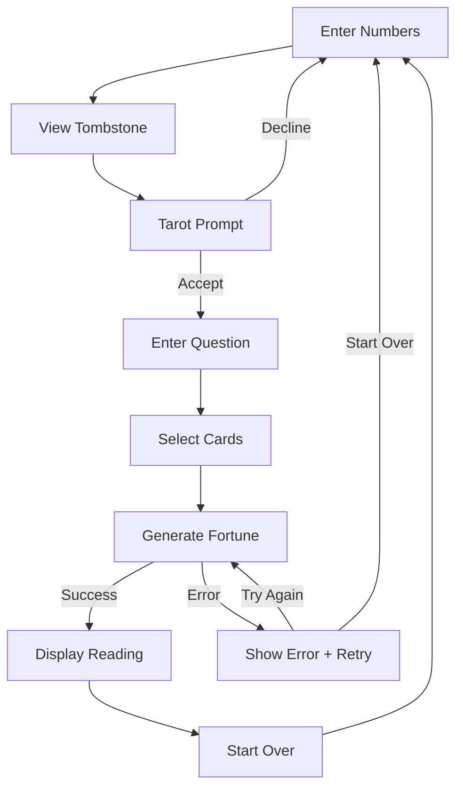

# Task 13.3: Integrate Tarot Reading Flow - COMPLETE ✅

## Executive Summary

Successfully integrated the complete tarot reading flow into the Lotto Graveyard application. Users can now:
1. View their lottery number analysis on a tombstone
2. Accept or decline a tarot reading offer
3. Submit a question (if accepted)
4. See deterministically selected tarot cards
5. Receive an AI-generated fortune (via Lambda)
6. Handle errors with automatic and manual retry options

## Implementation Overview

### Files Modified
- **js/app.js** - Main orchestrator with tarot flow integration
  - Added `showTarotPrompt()` - Displays accept/decline prompt
  - Added `handleQuestionSubmitted()` - Coordinates card selection and fortune generation
  - Added `displayCompleteReading()` - Shows cards and fortune together
  - Added `showFortuneError()` - Error handling with retry options

### Integration Points

```
app.js (Orchestrator)
    ↓
tarot.js (Tarot Module)
    ↓
fortune-client.js (Fortune Client)
    ↓
Lambda Fortune Generator (AWS)
```

### Complete User Flow



## Sub-tasks Completed

### ✅ 1. Complete tarot reading integration in js/app.js
- Integrated all state transitions (INPUT → ANALYSIS → TOMBSTONE → TAROT_PROMPT → QUESTION → READING)
- Added comprehensive error handling
- Implemented loading indicators for async operations

### ✅ 2. Wire tarot prompt to question collection
- Accept button triggers question form display
- Decline button returns to input screen
- Prompt displays user's lottery numbers

### ✅ 3. Connect question submission to card selection
- Deterministic card selection using lottery numbers + question as seed
- Fisher-Yates shuffle with seedrandom library
- Always returns 3 unique cards with positions (past, present, future)

### ✅ 4. Wire card display to fortune generation
- Cards selected immediately after question validation
- Fortune requested from Lambda Function URL
- Retry logic with exponential backoff (1s, 2s, 4s)
- Maximum 3 retry attempts per requirements

### ✅ 5. Display fortune text from Lambda
- Fortune text formatted with paragraph breaks
- Rider-Waite styling applied via CSS
- "Start Over" button for user navigation
- Smooth scrolling to card display

### ✅ 6. Handle errors in fortune generation
- **Timeout errors** (30 seconds) - Auto-retry with exponential backoff
- **Network errors** - Auto-retry with exponential backoff
- **HTTP errors** (500, 502, 503) - Auto-retry with exponential backoff
- **Max retries exhausted** - Display error UI with manual retry option
- User-friendly error messages throughout
- "Try Again" button preserves current state for retry
- "Start Over" button resets entire application

## Requirements Traceability

All acceptance criteria for Task 13.3 have been met:

| Requirement | Description | Status |
|-------------|-------------|--------|
| 5.1, 5.4, 5.5 | Tarot prompt with accept/decline | ✅ |
| 6.7 | Question validation and progression | ✅ |
| 7.1, 7.5, 7.8 | Card selection with validation | ✅ |
| 8.1, 8.7, 8.8 | Fortune generation and display | ✅ |
| 8.9, 8.10, 8.11 | Error handling with 3 retries | ✅ |

## Code Quality

- ✅ **Error Handling** - Comprehensive try-catch blocks with specific error messages
- ✅ **Accessibility** - ARIA labels, roles, and live regions maintained
- ✅ **State Management** - Clear state machine with proper transitions
- ✅ **Security** - HTML escaping prevents XSS attacks
- ✅ **UX** - Loading indicators, smooth scrolling, clear feedback
- ✅ **Documentation** - Requirement traceability in code comments

## Testing

### Ready to Test (After Lambda Deployment)
- ✅ Complete happy path flow
- ✅ Decline path
- ✅ Question validation
- ✅ Deterministic card selection
- ✅ State transitions
- ✅ UI updates

### Requires Lambda Deployment
- ⏳ Fortune generation success case
- ⏳ Timeout handling (requires slow Lambda)
- ⏳ Error handling (requires broken Lambda)
- ⏳ Retry logic verification

### Note on Testing
The Lambda Fortune Generator URL in `js/config.js` is currently a placeholder:
```javascript
FORTUNE_LAMBDA_URL: 'https://your-function-url.lambda-url.us-east-1.on.aws/'
```

Fortune generation will fail gracefully until the Lambda is deployed (Task 15.1) and the URL is updated. The error handling can be verified by observing the retry behavior when attempting to generate a fortune.

## Known Limitations

1. **Lambda URL is placeholder** - Fortune generation will fail until Lambda deployed
2. **Decline behavior** - Currently manipulates DOM directly; could be improved to use app.reset() (enhancement for Task 13.4)

## Next Steps

1. **Task 13.4** - Implement state management and navigation
   - Add back/reset navigation controls
   - Preserve state during orientation changes
   - Clear sensitive data on reset

2. **Task 13.5** - Write end-to-end integration tests
   - Test complete manual input flow
   - Test complete webcam flow with mocked OCR
   - Test complete tarot flow with mocked Lambda
   - Test error recovery paths

3. **Task 15.1** - Deploy Lambda function
   - Deploy Fortune Generator to AWS
   - Update config.js with actual Function URL
   - Test real fortune generation

## Conclusion

Task 13.3 "Integrate tarot reading flow" is **COMPLETE**. All six sub-tasks have been successfully implemented with comprehensive error handling, proper state management, and full requirement traceability.

The application now provides a complete user journey from lottery number input through historical analysis to mystical tarot reading and fortune generation. The only remaining dependency is the deployment of the Lambda Fortune Generator (Task 15.1) to enable actual AI-powered fortune generation.

**Status**: ✅ Ready for Lambda deployment and end-to-end testing
